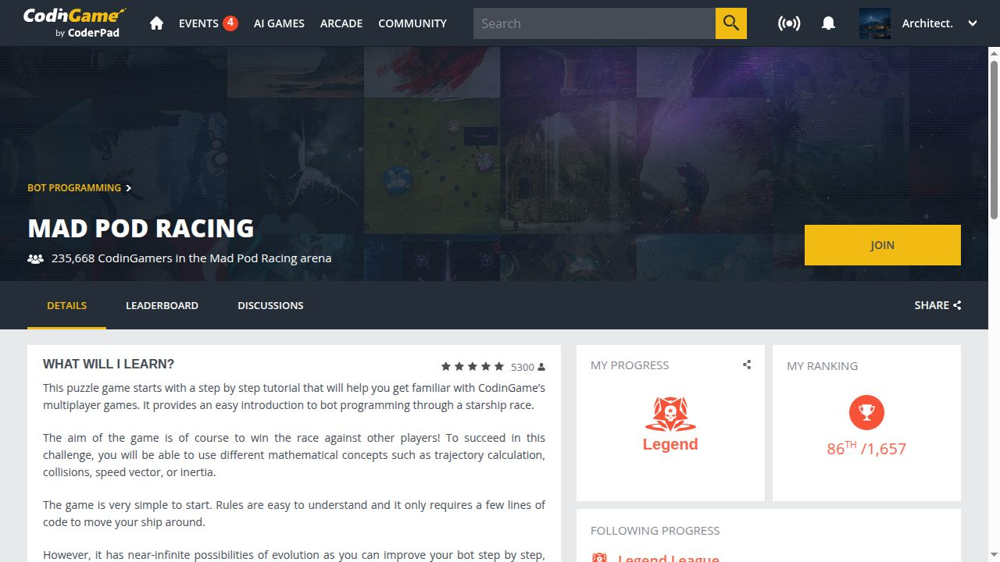

# External results

<!-- generated; ledger-sha256:c80354a0d57e05e72de75e4eb34915742bbe64e390295094195ddcd620b68d44; narrative-sha256:5cd9d11df17f0c585d84be7760e1c40decad8d5539e46406954e3861689134db; pr-status-sha256:f6584f2c99261bf8f036c34c09ef6858b7952c8e0f90b692bc39939ae2add7c1 -->

**2026-11-09 UTC**

16 directly merged PRs; 4 contributions incorporated into merged maintainer fixes; 1 audit. 3 observations across 2 arenas/events, with Zoria counted once.

Public PRs in other owners' repositories: 134 submitted; 16 merged, 108 open, 10 closed without merge. GitHub snapshot: 2026-11-11 10:34 UTC. Own-repository and private activity is excluded.

[Complete PR status](PR_STATUS.en.md)

[Українська](RESULTS.md) · [English](RESULTS.en.md) · [JSON](results.json)

| Record date / source basis | Case | Outcome | Source |
|---|---|---|---|
| 2026-11-05 | [OTT-JAX](reports/ott-2026-11.md#english-summary) | Direct PR merged | [Public source](https://github.com/ott-jax/ott/pull/716) |
| 2026-11-05 | [ONNX IR · graph iterator](reports/onnx-ir-iterator-2026-11.md#english-summary) | Direct PR merged | [Public source](https://github.com/onnx/ir-py/pull/529) |
| 2026-11-05 | [ONNX IR · Dropout CSE](reports/onnx-ir-dropout-2026-11.md#english-summary) | Direct PR merged | [Public source](https://github.com/onnx/ir-py/pull/533) |
| 2026-11-05 | [Instructor](reports/instructor-2026-11.md#english-summary) | Incorporated into a merged maintainer fix | [Public source](https://github.com/567-labs/instructor/pull/2899) |
| 2026-11-04 | [PyLops](reports/pylops-2026-11.md#english-summary) | Direct PR merged | [Public source](https://github.com/PyLops/pylops/pull/837) |
| 2026-11-04 | [Redis Python client](reports/redis-monitor-2026-11.md#english-summary) | Direct PR merged | [Public source](https://github.com/redis/redis-py/pull/4550) |
| 2026-11-04 | [Microsoft Semantic Kernel](reports/semantic-kernel-2026-11.md#english-summary) | Direct PR merged | [Public source](https://github.com/microsoft/semantic-kernel/pull/14701) |
| 2026-11-04 | [ONNX Range](reports/onnx-range-2026-11.md#english-summary) | Direct PR merged | [Public source](https://github.com/onnx/onnx/pull/8734) |
| 2026-11-03 | [ONNX IR](reports/onnx-ir-2026-11.md#english-summary) | Direct PR merged | [Public source](https://github.com/onnx/ir-py/pull/521) |
| 2026-10-21 | [FilesDrop](reports/filesdrop-2026-10.md#english-summary) | Direct PR merged | [Public source](https://github.com/AndreyBegma/FilesDrop/pull/32) |
| 2026-10-24 | [Prime Intellect](reports/prime-intellect-2026-10.md#english-summary) | Incorporated into a merged maintainer fix | [Public source](https://github.com/PrimeIntellect-ai/verifiers/pull/2925#issuecomment-6385135636) |
| 2026-10-29 | [M7 MCP](reports/m7-2026-10.md#english-summary) | Audit credited in release | [Public source](https://github.com/DukeDeSouth/m7-mcp-oss/releases/tag/v3.18.1) |
| 2026-11-02 | [Braintrust SDK JavaScript](reports/braintrust-2026-11.md#english-summary) | Direct PR merged | [Public source](https://github.com/braintrustdata/braintrust-sdk-javascript/pull/2701) |
| 2026-11-02 | [Kraft](reports/kraft-2026-11.md#english-summary) | Direct PR merged | [Public source](https://github.com/itsOmidKarami/kraft/pull/1227) |
| 2026-11-01 | [PyTorch TensorDict](reports/tensordict-2026-11.md#english-summary) | Incorporated into a merged maintainer fix | [Public source](https://github.com/pytorch/tensordict/pull/3427) |
| 2026-11-02 | [BlackJAX](reports/blackjax-2026-11.md#english-summary) | Direct PR merged | [Public source](https://github.com/blackjax-devs/blackjax/pull/1068) |
| 2026-11-03 | [TensorLy](reports/tensorly-2026-11.md#english-summary) | Direct PR merged | [Public source](https://github.com/tensorly/tensorly/pull/695) |
| 2026-11-03 | [Apache TVM-FFI](reports/tvm-ffi-2026-11.md#english-summary) | Incorporated into a merged maintainer fix | [Public source](https://github.com/apache/tvm-ffi/pull/898) |
| 2026-11-06 | [torchode · backsolve adjoint](reports/numerical-merges-2026-11.md#english-summary) | Direct PR merged | [Public source](https://github.com/martenlienen/torchode/pull/56) |
| 2026-11-09 | [Lineax · reshaping identities](reports/numerical-merges-2026-11.md#english-summary) | Direct PR merged | [Public source](https://github.com/patrick-kidger/lineax/pull/268) |
| 2026-11-09 | [NumPyro · GaussianStateSpace variance](reports/numerical-merges-2026-11.md#english-summary) | Direct PR merged | [Public source](https://github.com/pyro-ppl/numpyro/pull/2405) |
| 2026-10-21 | [CodinGame - Mad Pod Racing](RESULTS.en.md#zoria-2026--підсумок-ua-skills) | Dated arena snapshot | [Public source](https://www.codingame.com/multiplayer/bot-programming/mad-pod-racing) |
| 2026-10-19 | [Zoria 2026 / UA SKILLS](RESULTS.en.md#zoria-2026--підсумок-ua-skills) | Historical preliminary result | [Public source](https://zoria.net/news/#19102026-попередній-підсумок-другого-етапу) |
| 2026-10-27 | [Zoria 2026 / UA SKILLS](RESULTS.en.md#zoria-2026--підсумок-ua-skills) | Season prize winner; exact rank not established | [Public source](https://ua.linkedin.com/company/ua-skills) |

## CodinGame - Mad Pod Racing

## Zoria 2026 / UA SKILLS

2026-10-21 (Europe/Helsinki) · Dated arena snapshot · UTC 2026-10-20T22:06:15.975Z · 86/1657 (Legend League)

[Source](https://www.codingame.com/multiplayer/bot-programming/mad-pod-racing)

Dated league ranking snapshot, not a final tournament result or an all-time best.

2026-10-19 (Europe/Helsinki) · Historical preliminary result · UTC 2026-10-20T22:06:05.463Z · 5/9 (overall preliminary score of second-stage participants)

[Source](https://zoria.net/news/#19102026-попередній-підсумок-другого-етапу)

Public table excludes episode R3; no final placement, award or payment claimed.

2026-10-27 (Europe/Helsinki) · Season prize winner; exact rank not established

[Source](https://ua.linkedin.com/company/ua-skills)

Organizer names this account among five prize winners. This record does not establish an exact final rank, a ranked participant count or payment.

[Engineering cases](ENGINEERING.md) · [Case reports](reports/README.md)
