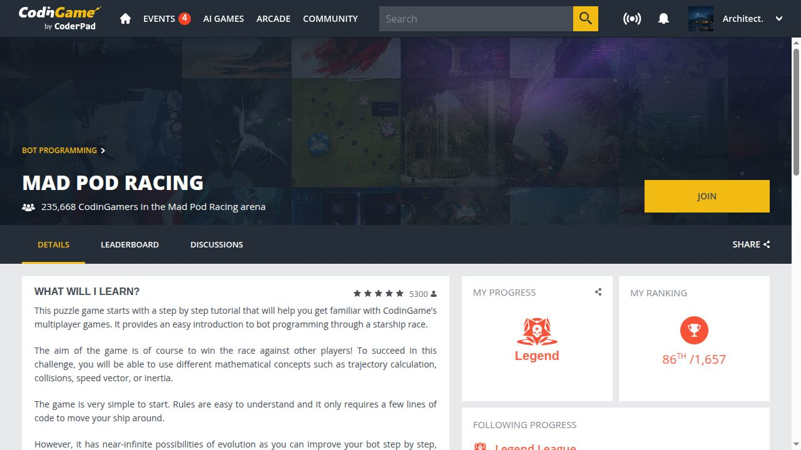

# Зовнішні результати

<!-- generated; ledger-sha256:01e1c97b07fc337e3b63a7e70911afad55c63a88a0c7a43b67c664eeb218abd4; narrative-sha256:d2dd325e8e8ab4f4a6b9a81fdb55e325b1b93f482a6ea60b3a1324dbf27e4cbe; pr-status-sha256:6cf76b0331c7751ed6b38b31ea7bb4b5800e5b141777137a1863ab267eb56d11 -->

**2026-11-05 UTC**

Власні злиті PR: 13; внески у злиті рішення мейнтейнерів: 4; технічні аудити: 1. Змагання: часових записів 3, подій 2; Zoria враховано один раз.

Публічні PR у чужих репозиторіях: 134 подано; 13 злитих, 113 відкритих, 8 закритих без merge. Зріз GitHub: 2026-11-05 21:47 UTC. Власна та приватна активність виключені.

[Повний стан PR](PR_STATUS.md)

[Українська](RESULTS.md) · [English](RESULTS.en.md) · [JSON](results.json)

| Дата запису / основа | Кейс | Зовнішній стан | Джерело |
|---|---|---|---|
| 2026-11-05 | [OTT-JAX](reports/ott-2026-11.md) | Власний PR merged | [Джерело](https://github.com/ott-jax/ott/pull/716) |
| 2026-11-05 | [ONNX IR · graph iterator](reports/onnx-ir-iterator-2026-11.md) | Власний PR merged | [Джерело](https://github.com/onnx/ir-py/pull/529) |
| 2026-11-05 | [ONNX IR · Dropout CSE](reports/onnx-ir-dropout-2026-11.md) | Власний PR merged | [Джерело](https://github.com/onnx/ir-py/pull/533) |
| 2026-11-05 | [Instructor](reports/instructor-2026-11.md) | Внесок у merged fix мейнтейнера | [Джерело](https://github.com/567-labs/instructor/pull/2899) |
| 2026-11-04 | [PyLops](reports/pylops-2026-11.md) | Власний PR merged | [Джерело](https://github.com/PyLops/pylops/pull/837) |
| 2026-11-04 | [Redis Python client](reports/redis-monitor-2026-11.md) | Власний PR merged | [Джерело](https://github.com/redis/redis-py/pull/4550) |
| 2026-11-04 | [Microsoft Semantic Kernel](reports/semantic-kernel-2026-11.md) | Власний PR merged | [Джерело](https://github.com/microsoft/semantic-kernel/pull/14701) |
| 2026-11-04 | [ONNX Range](reports/onnx-range-2026-11.md) | Власний PR merged | [Джерело](https://github.com/onnx/onnx/pull/8734) |
| 2026-11-03 | [ONNX IR](reports/onnx-ir-2026-11.md) | Власний PR merged | [Джерело](https://github.com/onnx/ir-py/pull/521) |
| 2026-10-21 | [FilesDrop](reports/filesdrop-2026-10.md) | Власний PR merged | [Джерело](https://github.com/AndreyBegma/FilesDrop/pull/32) |
| 2026-10-24 | [Prime Intellect](reports/prime-intellect-2026-10.md) | Внесок у merged fix мейнтейнера | [Джерело](https://github.com/PrimeIntellect-ai/verifiers/pull/2925#issuecomment-6385135636) |
| 2026-10-29 | [M7 MCP](reports/m7-2026-10.md) | Аудит відзначено в релізі | [Джерело](https://github.com/DukeDeSouth/m7-mcp-oss/releases/tag/v3.18.1) |
| 2026-11-02 | [Braintrust SDK JavaScript](reports/braintrust-2026-11.md) | Власний PR merged | [Джерело](https://github.com/braintrustdata/braintrust-sdk-javascript/pull/2701) |
| 2026-11-02 | [Kraft](reports/kraft-2026-11.md) | Власний PR merged | [Джерело](https://github.com/itsOmidKarami/kraft/pull/1227) |
| 2026-11-01 | [PyTorch TensorDict](reports/tensordict-2026-11.md) | Внесок у merged fix мейнтейнера | [Джерело](https://github.com/pytorch/tensordict/pull/3427) |
| 2026-11-02 | [BlackJAX](reports/blackjax-2026-11.md) | Власний PR merged | [Джерело](https://github.com/blackjax-devs/blackjax/pull/1068) |
| 2026-11-03 | [TensorLy](reports/tensorly-2026-11.md) | Власний PR merged | [Джерело](https://github.com/tensorly/tensorly/pull/695) |
| 2026-11-03 | [Apache TVM-FFI](reports/tvm-ffi-2026-11.md) | Внесок у merged fix мейнтейнера | [Джерело](https://github.com/apache/tvm-ffi/pull/898) |
| 2026-10-21 | [CodinGame - Mad Pod Racing](RESULTS.md#zoria-2026--підсумок-ua-skills) | Датований зріз арени | [Джерело](https://www.codingame.com/multiplayer/bot-programming/mad-pod-racing) |
| 2026-10-19 | [Zoria 2026 / UA SKILLS](RESULTS.md#zoria-2026--підсумок-ua-skills) | Історичний попередній результат | [Джерело](https://zoria.net/news/#19102026-попередній-підсумок-другого-етапу) |
| 2026-10-27 | [Zoria 2026 / UA SKILLS](RESULTS.md#zoria-2026--підсумок-ua-skills) | Призер сезону; точне місце не встановлено | [Джерело](https://ua.linkedin.com/company/ua-skills) |

## CodinGame - Mad Pod Racing

## Zoria 2026 / UA SKILLS

2026-10-21 (Europe/Helsinki) · Датований зріз арени · UTC 2026-10-20T22:06:15.975Z · 86/1657 (Legend League)

[Source](https://www.codingame.com/multiplayer/bot-programming/mad-pod-racing)

Датований зріз місця в лізі, не фінальний результат турніру й не найкраще місце за весь час.

2026-10-19 (Europe/Helsinki) · Історичний попередній результат · UTC 2026-10-20T22:06:05.463Z · 5/9 (загальний попередній підсумок учасників другого етапу)

[Source](https://zoria.net/news/#19102026-попередній-підсумок-другого-етапу)

Публічна таблиця не враховує епізод R3; цей запис не встановлює фінального місця, нагороди або виплати.

2026-10-27 (Europe/Helsinki) · Призер сезону; точне місце не встановлено

[Source](https://ua.linkedin.com/company/ua-skills)

Організатор називає цей обліковий запис серед п’яти призерів. Запис не встановлює точного фінального місця, кількості ранжованих учасників або виплати.

[Engineering cases](ENGINEERING.md) · [Case reports](reports/README.md)
